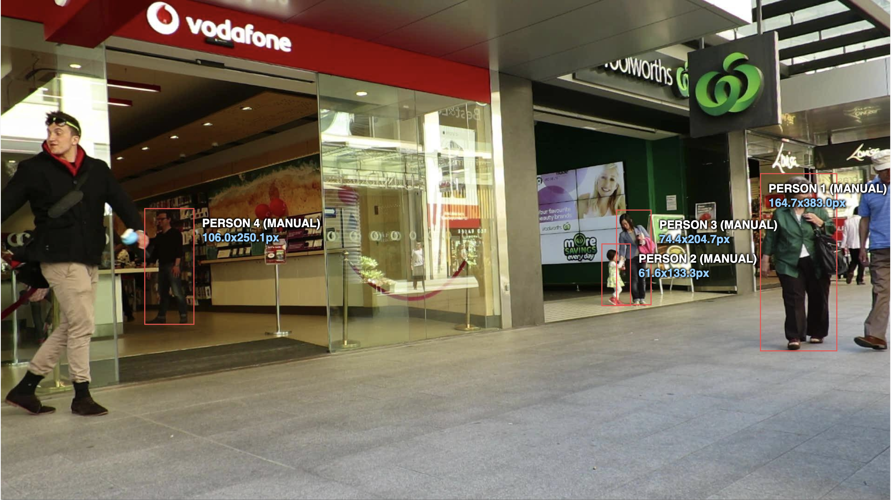
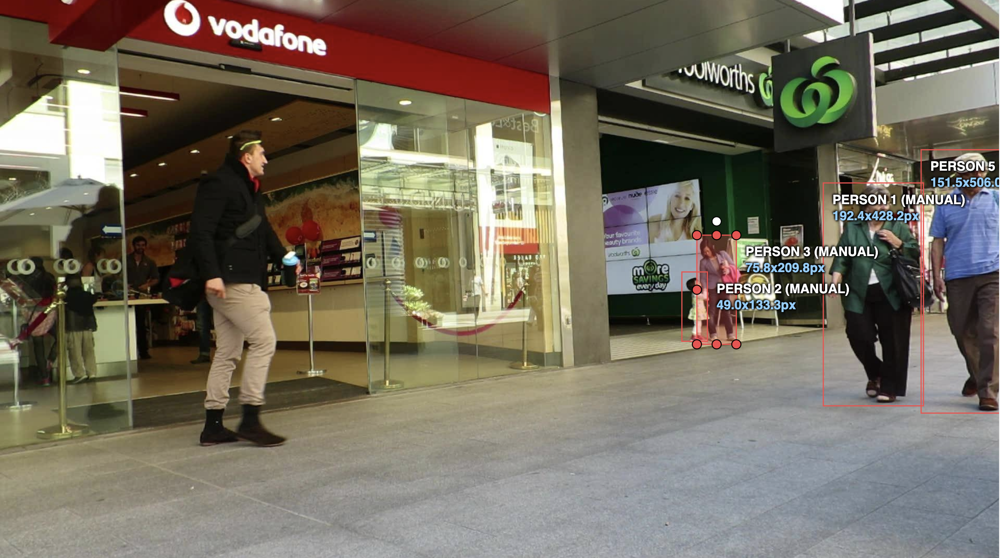
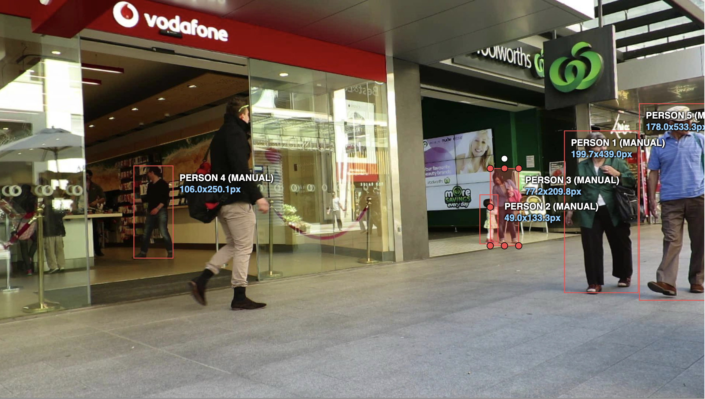

# Báo cáo cá nhân — NguyenXuanKhanh-2A202603075
 
Đoạn video: MOT17-09, 150 frame (frame 1–150), nguồn MOTChallenge, giấy phép CC BY-NC-SA 3.0.
 
> Chú thích: chỗ ghi **[ĐIỀN]** là phần chỉ bạn biết (quan sát, thời gian, ảnh chụp). Số liệu còn lại lấy từ kết quả `check_submission.py`. Ở đây giả định P1–P5 ứng với ID MOT 1–5 (CVAT track 0–4); sửa lại nếu bạn đánh số khác
## 0. Thông tin học viên
 
- Họ tên: Nguyễn Xuân Khánh
- MSSV: 2A202603075
- Mã đề (A/B/C): B (task `DAY05-MOT17-09-B-2A202603075`)
- Email: khanhblackjaky@gmail.com
- Link repository: https://github.com/Khanh-AI-ML-DL/K5-L2-NguyenXuanKhanh-2A202603075-MOTTracking
- Giờ bắt đầu: 16:30
- Giờ kết thúc: 17:30

## 1. Xem trước đoạn video (CP0)

Ghi **trước khi vẽ**, mỗi người một dòng.

 Mã | Frame xuất hiện | Frame cuối thấy được | Rẽ / dừng / đổi tốc độ ở frame | Bị che ở frame | Ghi chú |
|---|---|---|---|---|---|
| P1 | 0 | 149 |  | không bị che | Có mặt suốt đoạn |
| P2 | 0 | 148 | | 111–135 (khuất hẳn) | Có đoạn outside |
| P3 | 0 | 149 | | 43–49 (khuất hẳn) | Có đoạn outside ngắn |
| P4 | 2 | 104 | | không bị che | Rời khung sau frame 104 |
| P5 | 40 | 149 | | không bị che | Vào khung muộn |

## 2. Keyframe và thời gian (CP1, CP4)

Số keyframe lấy từ kết quả `src/check_submission.py`.

| Mã | Số keyframe | Keyframe ở frame | Số frame có mặt | Keyframe / 100 frame | Thời gian (phút) | Chỗ khó |
|---|---|---|---|---|---|---|
| P1 | 104 | 0, 1, 3, 4, 5, 6, 9, 13, 14, 16–19, 21, 23, 27–32, 34, 36, 37, 40, 43–45, 47, 50, 51, 53, 54, 56, 59, 61–66, 69, 70, 72, 74, 78–86, 88–91, 93, 96–99, 101–106, 108–111, 115, 116, 118, 120–124, 126–148 | 150 | 69,3 | |  |
| P2 | 14 | 0, 4, 12, 13, 16, 19, 29, 41, 102, 103, 106, 136, 140, 142 | 124 | 11,3 | | Đoạn khuất 111–135 |
| P3 | 15 | 2, 4, 8–11, 13, 14, 19, 24, 29, 35, 36, 91, 95 | 103 | 14,6 |  |  |
| P4 | 41 | 0, 6, 8, 10, 12, 15, 18, 21, 24, 27, 30, 33, 36, 50, 52, 54, 58, 60, 63, 65, 67, 69, 71, 73, 75, 80, 81, 84, 87, 89, 94, 99, 103, 112, 115, 123, 126, 128, 129, 146, 149 | 143 | 28,7 |  | Đoạn khuất 43–49 |
| P5 | 60 | 40, 42–44, 47, 49, 55, 57, 59, 62, 65, 67, 71, 77, 79, 81–83, 86, 90, 91, 93, 96, 97, 101, 102, 105, 107, 108, 111–114, 116, 118, 120, 122, 125–130, 132–139, 141–149 | 110 | 54,5 |  | |
| **Tổng** | **234** | | **630** | **37,1** | | |
> Lưu ý: bảng trên khớp theo thứ tự track trong file CVAT (track 0–4). Nhưng số frame có mặt của file CVAT (150, 124, 103, 143, 110) lại khớp với MOT theo ID 1, 2, 4, 3, 5 (ID3 có 143 frame, ID4 có 103 frame). Hãy đối chiếu lại thứ tự P3 và P4 trong CVAT trước khi nộp.
 
Keyframe / 100 frame của cả bài = 234 ÷ 630 × 100 = **37,1**.
 
Bạn đặt keyframe nhiều nhất ở người nào? Vì sao?
 
Nhiều nhất ở P1 (104 keyframe, 69,3/100 frame), tiếp theo là P5 (60 keyframe, 54,5/100 frame). Cả hai đều vượt ngưỡng 50 của script. **[ĐIỀN: lý do thật, ví dụ người đó đi chéo / lại gần camera nên box đổi kích thước nhanh, hoặc bạn đặt dày để an toàn. Nếu đã xóa bớt keyframe thì cập nhật số liệu.]**

## 3. Đoạn bị che (CP2)

Người bị che: `P_`

| Mốc | Frame |
|---|---:|
| Bắt đầu bị che một phần (bật `occluded`) | |
| Mất hẳn (bật `outside`) |111 |
| Hiện lại (tắt `outside`) |136 |
| Thấy rõ trở lại (tắt `occluded`) | |

- Thời gian khuất hẳn: _25_ frame = _25/ 30__ = 0,85 giây.
- Quyết định: giữ cùng ID / tạo track mới. outcside
- Lý do (trả lời 3 câu: khuất bao lâu so với 60 frame, ngoại hình có khớp, chỗ hiện lại có đúng hướng và tốc độ): Vật thể không quay trở lại 

...

Ảnh chụp màn hình:





## 4. Tự review ID (CP3)

Lượt 1 theo người (đi ngược từ frame 149 về 0 trên CVAT), lượt 2 theo cảnh (nhảy 10 frame). Ít nhất 3 dòng; không có lỗi thì ghi một dòng "đã kiểm hai lượt, không lỗi".

Loại lỗi dùng đúng một trong 7 mã: `id_switch`, `fragmentation`, `lost`, `merge`, `false_track`, `drift`, `flag`.

|| Frame | Mã người | Loại lỗi | Mô tả một câu | Phát hiện ở lượt | Đã sửa? |
|---:|---|---|---|---|---|
| 96–104 | P4 (ID 4) | `drift` | [Keyframe cuối ở frame 95 nhưng track kéo đến 104: box có đứng yên trong khi người vẫn đi không?] | [1 hoặc 2] | Có |
| 41–102 | P2 (ID 2) | `drift` | [Khoảng 61 frame không có keyframe: box nội suy có lệch khỏi người ở giữa đoạn không?] | [1 hoặc 2] | có |
| 136 | P2 (ID 2) | `id_switch` hoặc `lost` | [Sau khoảng vắng 111–135, box hiện lại có đúng người, đúng hướng và tốc độ không?] | [1 hoặc 2] | có |
| 43–49 | P3 (ID 3) | `lost` | [Khoảng vắng 7 frame: người có thật sự khuất hẳn, hay vẫn thấy một phần (đúng ra phải để `occluded`)?] | [1 hoặc 2] | có |
| 40 | P5 (ID 5) | `lost` | [Lùi vài frame trước frame 40: người đã xuất hiện sớm hơn chưa?] | [1 hoặc 2] | có |

Tổng hợp số lỗi theo loại:

| `id_switch` | `fragmentation` | `lost` | `merge` | `false_track` | `drift` | `flag` |
|---:|---:|---:|---:|---:|---:|---:|
| | | | | | | |

Lỗi nào chỉ lượt 2 (theo cảnh) mới thấy, lượt 1 (theo người) không thấy? Vì sao?

...

## 5. File xuất và kết quả tự kiểm (CP4)

| Kiểm tra | Kết quả |
|---|---|
| Tên file MOT 1.1 | 	NguyenXuanKhanh_mot.zip|
| Tên file CVAT for video 1.1 | NguyenXuanKhanh_cvat_video.zip |
| Số track ID khác nhau trong `gt/gt.txt` (phải là 5) |5 |
| Frame `outside` không có dòng trong `gt.txt` (đúng / sai) |Đúng: ID2 vắng 111–135, ID3 vắng 43–49 |
| Job đã completed trên CVAT máy cá nhân | http://localhost:8080/tasks/18/jobs/16|

Dán phần tóm tắt in ra từ `src/check_submission.py`:

```Số frame in theo CVAT (bắt đầu từ 0). Trong gt.txt, frame_id = frame CVAT + 1.

=== File MOT 1.1: NguyenXuanKhanh_mot.zip ===
  Số track ID: 5   |   Tổng số box: 630
  [OK]        Đúng 5 track ID.

  Track | Frame có mặt | Số frame | Đoạn vắng (outside)
      1 |   0–149      |      150 | -
      2 |   0–148      |      124 | 111–135
      3 |   0–149      |      143 | 43–49
      4 |   2–104      |      103 | -
      5 |  40–149      |      110 | -

=== File CVAT for video 1.1: NguyenXuanKhanh_cvat_video.zip ===
  Tổng: 234 keyframe / 630 frame có mặt = 37.1 keyframe / 100 frame
  [CẢNH BÁO]  Track 0: 69 keyframe / 100 frame > 50.
  [CẢNH BÁO]  Track 4: 55 keyframe / 100 frame > 50.
  Lỗi: 0   |   Cảnh báo: 2
```

## 6. Ba câu kết

1. Nếu được gán lại, bạn sẽ đặt keyframe khác ở đâu? Vì sao?

   Đoạn chuyển động , để có thể nhớ

2. Có chỗ nào bạn không chắc "cùng ID hay ID mới"? Bạn đã quyết định và ghi chú thế nào?

   ... KO

3. Một lỗi ID trong job của bạn (nếu không còn sót, chọn lỗi đã sửa) có thể làm xe tự lái dự đoán sai chuyển động của người đó như thế nào? Lỗi đó ảnh hưởng MOTA hay IDF1 nhiều hơn?

   ... Ko lỗi 

## Bonus (nếu làm)

### B1 — Hai người đi sát

...

### B2 — So cách đặt keyframe

| Cách đặt | Số keyframe | Frame trôi nhất | Ghi chú |
|---|---:|---:|---|
| Đều mỗi 30 frame | | | |
| Theo chỗ đổi hướng | | | |

...

### B3 — So với tracker có sẵn

| Frame | Mã người | Tracker làm gì | Nhãn của bạn | Giải thích (đoán rồi sửa / ghép IoU / box score thấp / ngoại hình) |
|---:|---|---|---|---|
| | | | | |
| | | | | |

## 7. Tài liệu tham khảo và công cụ AI đã dùng

...
